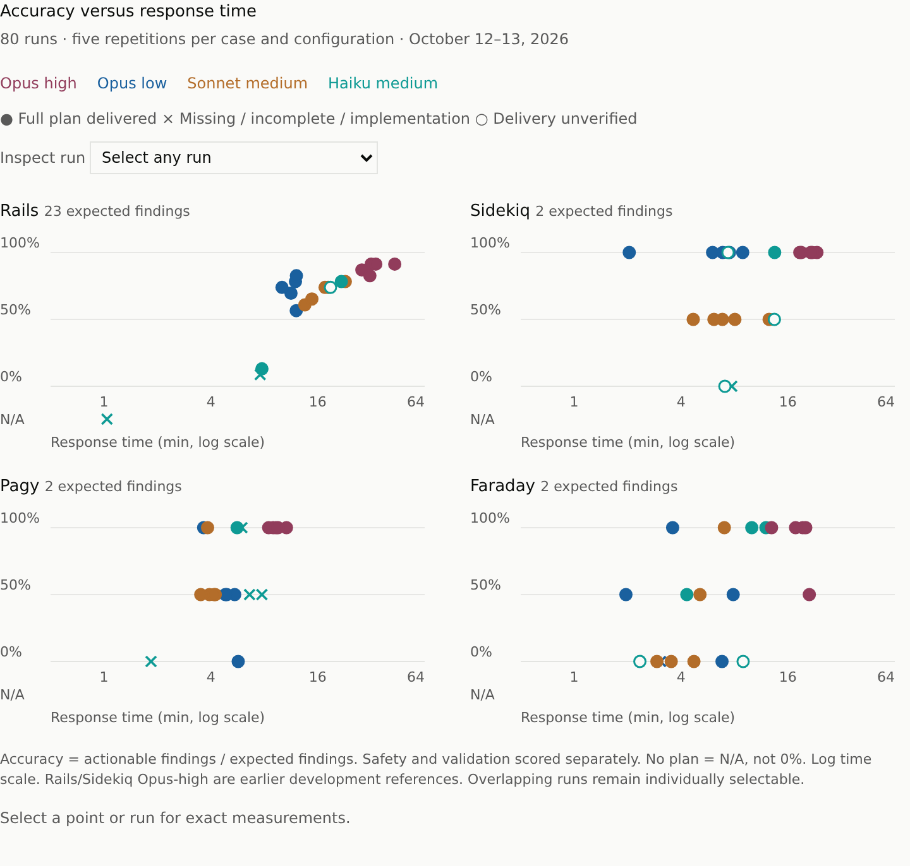
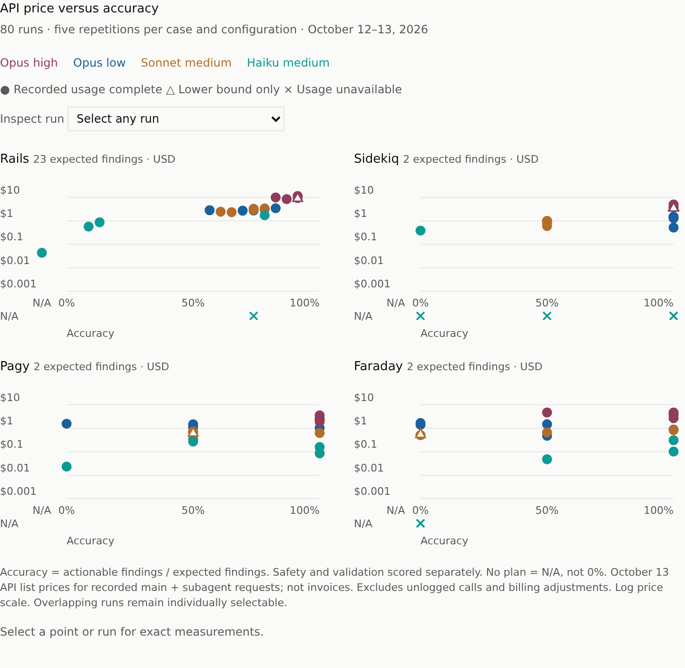

# Frozen planner benchmark results

All 80 benchmark slots are assessed: Opus 5.5/high and low, Sonnet 5.5/medium and
Haiku 5.5/medium, five repetitions each of Rails, Sidekiq, Pagy and Faraday.
Opus-high Rails/Sidekiq are earlier development references. Its Pagy/Faraday
supplement ran on October 13 using identical frozen prompt/application bytes
in the isolated app-only worker project. The different date and setup route
limit causal interpretations of timing differences. No held-out prompt tuning occurred.

Start with [per-run outcomes](benchmark-outcomes.csv), their
[JSON equivalent](benchmark-outcomes.json), or
[descriptive statistics](benchmark-statistics.json). The
[cycle record](../../planner-suite-20261012.md) explains the protocol, findings
and prior failed attempts. The [failure ledger](../../planner-failures-20261012.json)
keeps early failures separate from later recovery.





The first graph compares accuracy with request-to-last-response time, including
failed workflows; the second plots accuracy vertically and API price horizontally.
Filled circles
in the first graph indicate full designated-plan delivery, crosses
indicate missing/incomplete plans or implementation, and hollow circles indicate
unverified native delivery. The generated interactive graph views let readers
select every run, including overlapping points, and inspect native token
counters. API-cost circles are recorded-request estimates, triangles are lower
bounds, and crosses are unavailable usage, never zero cost.

## Read the measurements with their limits

- `raw_actionable` and `final_actionable` count selected findings with supported
  application impact, applicability and repair. The denominator is 23 for Rails
  and two for each other case. The graphs call this fraction accuracy; it measures
  expected findings, not overall safety, validation or readiness. Errors and unsafe
  recommendations are assessed separately. A missing plan has N/A accuracy, not zero.
- `response_wall_time_ms` measures initial request to last evaluated idle state,
  including startup and the parent's retries. It includes missing-plan responses,
  summaries and implementation outcomes. Do not call every response a success.
- `successful_plan_wall_time_ms` is null when full designated-plan delivery is
  absent or unverified. Haiku has seven eligible deliveries among twenty attempts.
  Full delivery may be nonliteral, but a lossy last summary is not a full report.
  Opus-low Faraday2 also has an incomplete last response.
- `reported_planner_tokens` contains the first native handback's usage footer
  when available: 68 of 80 slots. Some Haiku footers describe a status handback.
  October 13 handbacks call the field `subagent_tokens`; earlier ones use `total_tokens`.
  These are neither total workflow tokens nor billed usage. Do not sum nested
  footers. Additional footer values remain in the per-run assessments.
- Statistics retain sample sizes, median, range and sample standard deviation.
  They describe these repetitions, not model reliability. Final-content statistics
  include implementation summaries; null no-plan scores are excluded explicitly.
  Eligible full-plan timing statistics have their own smaller sample sizes.

## Costs cover recorded requests, not invoices

[Per-run costs](benchmark-costs.csv) and their [JSON evidence](benchmark-costs.json)
contain 68 list-price estimates, five lower bounds and seven unavailable costs.
All include uncached input, known final output, cache reads and cache writes when
available. Thinking is already inside output tokens; it is not added again.
Cache-write TTLs, recorded request modifiers and Haiku's per-request long-context
threshold use the [October 13 price snapshot](../../api-pricing-20261013.json).

The five lower-bound runs lack final output for at least one native request:
Opus-high Rails1 and Sidekiq1/3, Sonnet Pagy1 and Faraday2. Streaming output
placeholders are excluded. Seven Haiku costs are unavailable after collection
refusals: Rails4, Sidekiq2/3/4/5 and Faraday1/5. Missing data stays null.
The [recovery verification](usage-recovery/verification.json) records counts,
fingerprints and the wider earlier audit windows that explain noncomparable hashes.
It does not reproduce remote source bytes. Growing transcript whole-file hashes
are not original-prefix hashes, and split assistant rows are not unique requests.

Collection-only turns, unlogged helper calls, orb charges and billing adjustments
are excluded. Seven quota-interrupted Opus-high attempts retain their own usage
and cost bounds under `quota-interrupted/opus-high-heldout/`; their spend is not
added to fresh replacement costs. These figures do not establish subscription bills.

Regenerate costs, statistics and the two self-contained interactive graph views:

```sh
node scripts/summarize-results.ts tests/results/20261012 --views /tmp/planner-views
```

A Python generator wrote the published files. The TypeScript port produces the same
keys, CSV and cost values, but writes `0` for `0.0` and computes 21 means and
standard deviations that differ from Python's exact arithmetic in the last digits.
Regenerating therefore changes file hashes recorded in the evidence index.

## Find the evidence for a run

The [evidence index](evidence-index.json) maps published files to original sources
and SHA-256 hashes. `saved_trace` in each outcome points to its reviewed visible
trace: original request, main tool inputs/results, all parent responses, final
text, model features and immutable evaluated boundary. Original absolute paths
inside assessments are provenance, not required local dependencies. Locate the
corresponding published file through the index or the directories below.

- `assessments/`: every selected raw/final finding judgment, quoted evidence,
  alternate substantive reports, validation gaps, errors and delivery differences.
- `*-models/` and `*-reports/`: recovered original native metadata and public
  reports. Audit availability does not mean a plan was delivered. Fourteen Haiku
  audits are available, including two planner-bypass runs.
- `sources/`: initial application/plugin revision and prompt-hash audits.
- `*/usage/`: usage-only original native requests within each scored boundary.
- `sources/isolated-worker/`: eval-owned setup receipts for the Opus-high supplement.
- `early-observations/`: initial waiting responses before later spontaneous reports.
- `quota-interrupted/`, `source-drift-excluded/`, `excluded/` and
  `superseded-development/`: earlier attempts outside the frozen benchmark table.
- `collection-refusals/`: six post-evaluation evidence-collection refusals,
  excluded from benchmark inputs, grades and elapsed time.
- `development-research/`: available diagnostic and first-batch trial logs,
  lockfiles and proposed patches. These prove only their named trial variants.
  They are evidence records, not changes integrated into the application.

Six Haiku model audits remain unavailable: Rails4, Sidekiq2/4/5 and Faraday1/5.
The requested configuration does not establish their actual served model.
Nested experiment logs were not generally collected, so claims in plans remain
attributed. The Pagy3 native artifact leaves CLI version unknown despite its
sender's contrary summary; its recovered usage now records CLI 2.1.296.

Full private exports, thinking/signature blocks and account/environment metadata
are excluded. An embedded native dump and literal Basic-auth values were removed
or redacted, preserving transformation reasons and original hashes in the index.
Published hashes describe the filtered files; source hashes describe their
unfiltered predecessors. Redaction does not change grades. The temporary project
pre-setup pin was restored to its previous empty value after the final batch.
